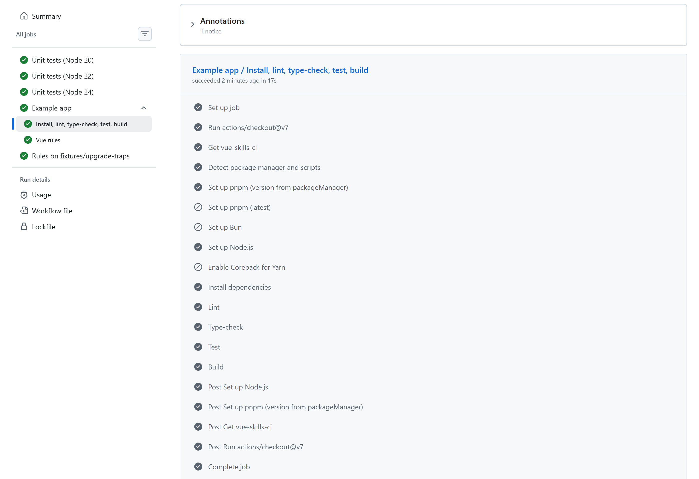
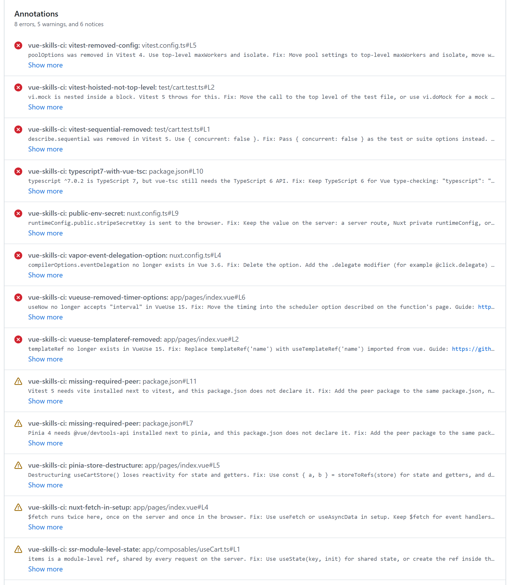
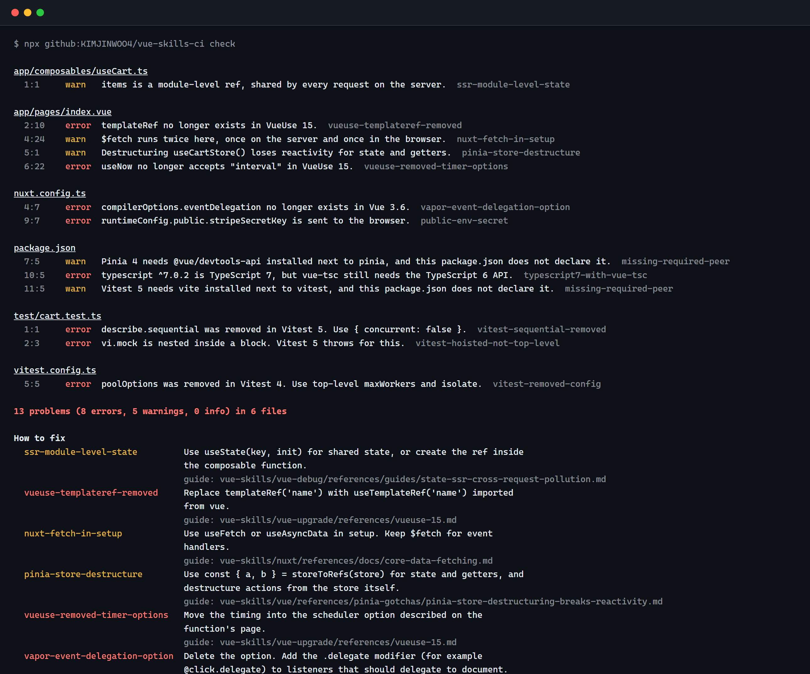

# vue-skills-ci

A ready-made GitHub Actions CI for Vue and Nuxt projects, plus 19 checks for the upgrade and safety problems that linters miss: TypeScript 7 under vue-tsc, Pinia 4 and Vitest 5 peers, options removed in VueUse 15 and Vitest 5, Vapor Mode settings, public env secrets and SSR state leaks.

[](https://github.com/KIMJINWOO4/vue-skills-ci/actions/workflows/ci.yml)


[](LICENSE)

Every rule links to the guide in [vue-skills](https://github.com/KIMJINWOO4/vue-skills) that explains the problem, so a person or an AI agent can go from a red check to the fix in one click.

## Why run it in CI

The releases since July 2026 changed a lot at once: TypeScript 7, Pinia 4, Vitest 5, VueUse 15, Vite 8.3, Nuxt 4.6 and the Vue 3.6 release candidates. Most projects meet these changes in a dependency pull request, and that pull request is where this check runs.

- Some of these problems pass the build, the tests and ESLint. A secret behind a `VITE_` prefix ships to every visitor. A module-level `ref` in a Nuxt composable works in development and leaks one user's data into another user's page under real traffic. A destructured Pinia store compiles fine and stops updating the UI.
- Others fail with an error that does not say why. vue-tsc on TypeScript 7 stops with an exports error about `./lib/tsc`. Vitest 5 throws on a `vi.mock` inside a `describe`. The annotation names the cause, the fix and the guide, on the line that needs to change.
- Renovate and Dependabot open the major bumps for you. When `typescript` goes to 7 or `@vueuse/core` to 15, the check on that pull request points out what else has to change before you merge it.
- AI coding assistants learned from documentation older than these releases, so they can still write `templateRef`, `describe.sequential` or guards that call `next()`. The rules catch that in review instead of in production.
- It is cheap to run. The rule job needs no install, no secrets and only read access, finishes in a few seconds, and runs next to your build.
- You can add it to an old codebase today. A [baseline](#existing-projects) records the current findings, so only new problems fail the check.

## Use the whole CI

Create `.github/workflows/ci.yml` in your project:

```yaml
name: CI
on:
  pull_request:
  push:
    branches: [main]

jobs:
  vue:
    uses: KIMJINWOO4/vue-skills-ci/.github/workflows/vue-ci.yml@v1
```

Or let the CLI write it for you:

```bash
npx -y github:KIMJINWOO4/vue-skills-ci init
```

That is the whole setup. The workflow reads your repository and runs two jobs in parallel.

| Job | What it does |
|-----|--------------|
| Install, lint, type-check, test, build | Picks pnpm, npm, Yarn or Bun from your lockfile, installs with the lockfile frozen, then runs each of these scripts if `package.json` has it: `lint`, `typecheck` or `type-check`, `test:unit` or `test`, `build-only` or `build`. |
| Vue rules | Runs the 19 checks and puts each finding on the pull request diff, with a summary on the run page. |

Script names follow [create-vue](https://github.com/vuejs/create-vue), so a freshly scaffolded app works without changes. A step whose script does not exist is skipped, not failed.



<sub>A real run of this repository's CI: the [example app](example) goes through every step of the reusable workflow in 17 seconds. [Open the run](https://github.com/KIMJINWOO4/vue-skills-ci/actions/runs/38697205118).</sub>

### Options

```yaml
jobs:
  vue:
    uses: KIMJINWOO4/vue-skills-ci/.github/workflows/vue-ci.yml@v1
    with:
      working-directory: apps/web   # monorepo: the folder with the app's package.json
      node-version: '22'
      test: false                   # skip a step
      rules: toolchain,security     # run only these rule groups
      fail-on: warn                 # make rule warnings fail the check too
      baseline: .vue-skills-ci-baseline.json
```

| Input | Default | Meaning |
|-------|---------|---------|
| `working-directory` | `.` | Folder with the app's `package.json`. The lockfile is found by walking up, so workspaces work. |
| `node-version` | `24` | Node.js version for install, lint, test and build. |
| `lint`, `typecheck`, `test`, `build` | `true` | Turn a step off. |
| `rules` | `all` | Rule groups or ids to run, comma separated. `none` turns the rule job off. See [Choose which rules run](#choose-which-rules-run). |
| `skip-rules` | | Rule groups or ids to leave out. |
| `fail-on` | `error` | Lowest rule severity that fails the check: `error`, `warn`, `info` or `never`. |
| `baseline` | | File of known findings to ignore (see [Existing projects](#existing-projects)). |

## Add only the checks

If you already have a CI workflow, add one step:

```yaml
steps:
  - uses: actions/checkout@v7
  - uses: KIMJINWOO4/vue-skills-ci@v1
```

The action takes `rules`, `skip-rules`, `path`, `fail-on`, `baseline` and `sarif` inputs. `npx -y github:KIMJINWOO4/vue-skills-ci init --rules-only` writes this workflow.

Each finding becomes an annotation with the reason, the fix and a link to the guide:



<sub>The rule check on [fixtures/upgrade-traps](fixtures/upgrade-traps) in this repository's CI. On a pull request the same messages also appear inline on the changed lines.</sub>

To see the findings in the repository's Security tab as well, write SARIF and upload it:

```yaml
permissions:
  security-events: write
steps:
  - uses: actions/checkout@v7
  - uses: KIMJINWOO4/vue-skills-ci@v1
    with:
      sarif: vue-skills-ci.sarif
  - uses: github/codeql-action/upload-sarif@v4
    if: always()
    with:
      sarif_file: vue-skills-ci.sarif
```

## Run it locally

```bash
npx -y github:KIMJINWOO4/vue-skills-ci check
```



<sub>Real output on [fixtures/upgrade-traps](fixtures/upgrade-traps), a Nuxt project with the mistakes people make while upgrading.</sub>

It needs Node 20 or newer and installs nothing else. Useful flags: `--format json`, `--fail-on warn`, `--rule <id>`, `--output report.md --format markdown`. Run `vue-skills-ci --help` for the rest.

## Let an AI agent run it

The repository ships a `vue-ci` skill. An agent with it runs the check, follows each finding's guide link and fixes the code, or sets up the CI above.

```bash
npx skills add KIMJINWOO4/vue-skills-ci
```

Install [vue-skills](https://github.com/KIMJINWOO4/vue-skills) as well and the agent reads the guides from disk instead of the web.

## Choose which rules run

All 19 rules run by default. Most projects only need some of them, so the rules come in six groups:

| Group | Turn it on when | Rules |
|-------|-----------------|-------|
| `toolchain` | Always. Catches broken version combinations before they break the build. | 5 |
| `testing` | The project uses Vitest 4 or 5. | 4 |
| `vapor` | The project tries Vue 3.6 Vapor Mode. | 3 |
| `vue` | The project uses VueUse, Vue Router or Pinia. | 4 |
| `nuxt` | Nuxt with server rendering. Skipped automatically when `ssr: false`. | 2 |
| `security` | Always. Finds secrets that would ship to the browser. | 1 |

Rules also stay quiet when they cannot apply: the Vitest rules need Vitest 4 or newer, the Nuxt rules need Nuxt, and the Vapor rules only look at Vapor components. So choosing groups mostly decides how much the team wants enforced.

Pick groups, single rules, or both. The same names work everywhere:

```yaml
# reusable workflow or action
with:
  rules: toolchain,security,testing
  skip-rules: prerelease-core-dependency
```

```bash
# command line
npx -y github:KIMJINWOO4/vue-skills-ci check --rules toolchain,security
npx -y github:KIMJINWOO4/vue-skills-ci rules          # list groups and rules
```

The same choice can live in `vue-skills-ci.config.json`, which the CLI, the action and the workflow all read:

```json
{
  "include": ["toolchain", "security", "testing"],
  "exclude": ["prerelease-core-dependency"]
}
```

When the workflow or the command line sets `rules` or `skip-rules`, that value replaces the matching list in the config file. Run `init` in a terminal and it asks which groups you want, then writes them into the workflow file.

## What the rules check

<!-- rules:start -->
| Group | Rule | Default | Catches |
|-------|------|---------|---------|
| **toolchain** | [`typescript7-with-vue-tsc`](https://github.com/KIMJINWOO4/vue-skills/blob/main/skills/build-tooling/references/typescript-7.md) | error | vue-tsc running on TypeScript 7 |
|  | [`missing-required-peer`](https://github.com/KIMJINWOO4/vue-skills/blob/main/skills/vue-upgrade/references/pinia-4.md) | warn | Required peer dependency not declared |
|  | [`end-of-life-framework`](https://github.com/KIMJINWOO4/vue-skills/blob/main/skills/vue-upgrade/SKILL.md) | warn | Framework version past end of life |
|  | [`prerelease-core-dependency`](https://github.com/KIMJINWOO4/vue-skills/blob/main/skills/vue-upgrade/references/versions.md) | info | Core package on a pre-release |
|  | [`vite8-legacy-options`](https://github.com/KIMJINWOO4/vue-skills/blob/main/skills/vue-upgrade/references/vite-8.md) | warn | Vite 7 option names in a Vite 8 config |
| **testing** | [`vitest-removed-config`](https://github.com/KIMJINWOO4/vue-skills/blob/main/skills/vue-upgrade/references/vitest-5.md) | error | Vitest config option that no longer exists |
|  | [`vitest-artifacts-not-ignored`](https://github.com/KIMJINWOO4/vue-skills/blob/main/skills/vue-upgrade/references/vitest-5.md) | info | .vitest output folder not in .gitignore |
|  | [`vitest-sequential-removed`](https://github.com/KIMJINWOO4/vue-skills/blob/main/skills/vue-upgrade/references/vitest-5.md) | error | .sequential test modifier |
|  | [`vitest-hoisted-not-top-level`](https://github.com/KIMJINWOO4/vue-skills/blob/main/skills/vue-upgrade/references/vitest-5.md) | error | vi.mock, vi.unmock or vi.hoisted below the top level |
| **vapor** | [`vapor-event-delegation-option`](https://github.com/KIMJINWOO4/vue-skills/blob/main/skills/vue/references/vue-36-vapor.md) | error | Removed Vapor eventDelegation compiler option |
|  | [`vapor-without-script-setup`](https://github.com/KIMJINWOO4/vue-skills/blob/main/skills/vue/references/vue-36-vapor.md) | error | Vapor component without script setup |
|  | [`vapor-unsupported-feature`](https://github.com/KIMJINWOO4/vue-skills/blob/main/skills/vue/references/vue-36-vapor.md) | warn | Feature that Vapor Mode does not support |
| **vue** | [`vueuse-templateref-removed`](https://github.com/KIMJINWOO4/vue-skills/blob/main/skills/vue-upgrade/references/vueuse-15.md) | error | templateRef imported from VueUse |
|  | [`vueuse-removed-timer-options`](https://github.com/KIMJINWOO4/vue-skills/blob/main/skills/vue-upgrade/references/vueuse-15.md) | error | VueUse timer option removed in v15 |
|  | [`router-guard-next-callback`](https://github.com/KIMJINWOO4/vue-skills/blob/main/skills/vue/references/router/router-navigation-guard-next-deprecated.md) | warn | Navigation guard using next() |
|  | [`pinia-store-destructure`](https://github.com/KIMJINWOO4/vue-skills/blob/main/skills/vue/references/pinia-gotchas/pinia-store-destructuring-breaks-reactivity.md) | warn | Pinia store destructured without storeToRefs |
| **nuxt** | [`ssr-module-level-state`](https://github.com/KIMJINWOO4/vue-skills/blob/main/skills/vue-debug/references/guides/state-ssr-cross-request-pollution.md) | warn | Module-level reactive state in a Nuxt composable |
|  | [`nuxt-fetch-in-setup`](https://github.com/KIMJINWOO4/vue-skills/blob/main/skills/nuxt/references/docs/core-data-fetching.md) | warn | $fetch at the top level of script setup |
| **security** | [`public-env-secret`](https://github.com/KIMJINWOO4/vue-skills/blob/main/skills/vue-review/references/checklist.md) | error | Secret exposed through a public env variable |
<!-- rules:end -->

Details for each rule, with the reason and the fix: [docs/rules.md](docs/rules.md).

ESLint looks at one file at a time and does not know which version of Vitest or VueUse you installed. These rules read `package.json`, pnpm catalogs, config files and source together, so they can tell that `poolOptions` is a problem on Vitest 4 but fine on Vitest 3. Keep using ESLint with [eslint-plugin-vue](https://eslint.vuejs.org) for template and style rules; the two do not overlap.

## Existing projects

A large codebase may start with dozens of findings. Record them once, and CI fails only on new ones:

```bash
npx -y github:KIMJINWOO4/vue-skills-ci check --baseline .vue-skills-ci-baseline.json --update-baseline
```

Commit the file and pass it as `baseline`. Findings are matched by rule, file and the text of the line, so moving code up or down does not break the match. Run the same command again after fixing some of them.

## Configuration

Everything lives in `vue-skills-ci.config.json` at the project root:

```json
{
  "include": ["toolchain", "security", "vue"],
  "exclude": ["pinia-store-destructure"],
  "rules": {
    "prerelease-core-dependency": "warn",
    "router-guard-next-callback": "error"
  },
  "ignore": ["legacy/**"]
}
```

`include` and `exclude` choose rules, `rules` changes a rule's severity (`error`, `warn`, `info` or `off`), and `ignore` skips paths.

Silence a single line with a comment above it: `// vue-skills-ci-disable-next-line ssr-module-level-state`. `node_modules`, `dist`, `.nuxt`, `.output`, `public` and files over 1 MB are always skipped.

## The example app

[`example/`](example) is a small todo app in the create-vue layout: Vue 3.5, Pinia 4, VueUse 15, Vite 8, Vitest 5 with Vue Test Utils, ESLint with eslint-plugin-vue, and vue-tsc on TypeScript 6. This repository's [CI](.github/workflows/ci.yml) calls the reusable workflow on it for every push and pull request, the same way your project would. If you want to see exactly what the workflow runs, open the latest run of the `Example app` job.

## Badge

If the check runs in your project, you can say so in your README:

[](https://github.com/KIMJINWOO4/vue-skills-ci)

```md
[](https://github.com/KIMJINWOO4/vue-skills-ci)
```

## Contributing

Rules live in [`src/rules`](src/rules), one object per rule with its reason, fix and guide link. Each rule has a failing and a passing case in [`test/rules.test.mjs`](test/rules.test.mjs).

```bash
npm test             # node:test, no install needed
npm run docs         # regenerate docs/rules.md and the table above
npm run check:examples
```

A good new rule catches something real that ESLint cannot see, has a guide in vue-skills to link to, and stays quiet on correct code.

## License

MIT
